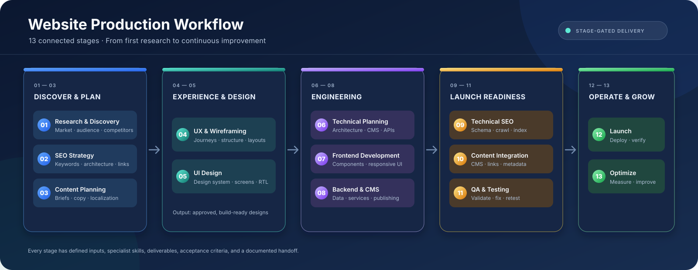
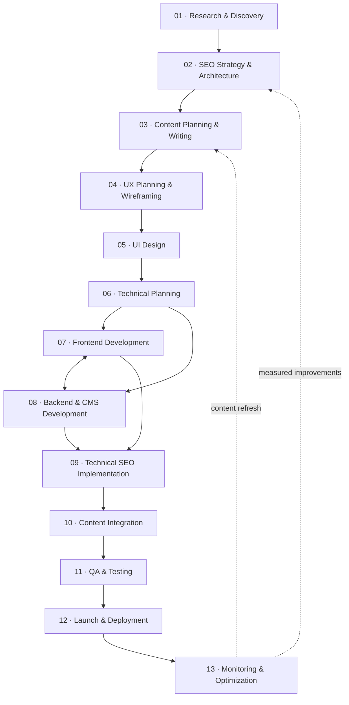

<div align="center">
  

  # Website Production Workflow

  **A practical, stage-gated system for planning, designing, building, launching, and improving websites.**

  <p>
    
    
    
    
  </p>

  [Get Started](#-quick-start) · [Explore the 13 Stages](#-the-13-stages) · [Workflow Rules](#-how-the-workflows-runs) · [Arabic Guide](README_AR.md)
</div>

---

## What this repository is

Website Production Workflow is a reusable operating system for website projects. It breaks the work into **13 specialist stages**, each with a focused prompt, required skills, dependencies, execution instructions, deliverables, and acceptance criteria.

Use it with AI agents, human specialists, or a mixed team. It is designed to make handoffs explicit, reduce repeated work, and keep strategy, content, UX, design, engineering, SEO, and QA aligned.

> [!IMPORTANT]
> This repository contains workflow guidance and prompt templates. It does **not** mean that research, development, testing, or deployment has already been performed. A stage is complete only when its work has been carried out and its deliverables have been produced, checked, and approved.

## ✨ What you get

- **13 connected stages** — from discovery and research to post-launch optimization.
- **Reusable specialist prompts** — one execution file for each stage.
- **Shared project context** — configure the project once and reuse it throughout the workflow.
- **Explicit dependencies** — every stage identifies the previous work it needs.
- **Quality gates** — acceptance criteria help determine whether a stage is ready to hand off.
- **Bilingual guidance** — English and Arabic user guides; execution prompts are written in English.
- **Human + AI collaboration** — suitable for individual workflows, specialist teams, or multi-agent orchestration.

---

## 🚀 Quick Start

### 1. Configure the project

Open [`00_PROJECT_CONFIGURATION.md`](00_PROJECT_CONFIGURATION.md) and fill in the information you already know. Leave unknown fields blank. Do not invent answers just to complete the form.

### 2. Read the shared instructions

Read [`00_MASTER_INSTRUCTIONS.md`](00_MASTER_INSTRUCTIONS.md). These rules apply to every stage and should be included whenever you run a stage prompt.

### 3. Choose the first stage

Start with **Stage 01 — Research & Discovery**. Use [`00_WORKFLOW_OVERVIEW.md`](00_WORKFLOW_OVERVIEW.md) for the full sequence and [`STAGE_INDEX.md`](STAGE_INDEX.md) to open an individual prompt.

### 4. Give the agent the right context

For each stage, provide all of the following:

1. The shared master instructions.
2. The completed project configuration.
3. The **READY-TO-USE PROMPT** from the selected stage file.
4. The actual deliverables from the earlier stages listed under that stage's dependencies.

**Do not assume an AI agent can automatically access previous files.** Attach them, provide accessible repository paths, or connect the agent to the project repository and explicitly ask it to read them.

### 5. Review, approve, and hand off

Check the stage's acceptance criteria. Complete [`HANDOFF_TEMPLATE.md`](HANDOFF_TEMPLATE.md), save the real deliverables, and approve the handoff before starting dependent work.

---

## 🧭 The 13 Stages

| # | Stage | Core skills | Main output | Prompt |
|---:|---|---|---|---|
| 01 | **Research & Discovery** | Market research, competitor analysis, audience research, business analysis, UX research | Research report, audience personas, business requirements, project scope | [Open stage](STAGES/01_Research_and_Discovery.md) |
| 02 | **SEO Strategy & Architecture** | SEO audit, keyword research, search intent, topical mapping, site architecture, internal linking | SEO audit, keyword map, sitemap, URL map, internal-linking blueprint | [Open stage](STAGES/02_SEO_Strategy_and_Architecture.md) |
| 03 | **Content Planning & Writing** | Content strategy, content briefs, SEO copywriting, semantic SEO, localization, editorial review | Content plan, page briefs, page copy, metadata, FAQs, source notes | [Open stage](STAGES/03_Content_Planning_and_Writing.md) |
| 04 | **UX Planning & Wireframing** | UX research, information architecture, user journeys, wireframing, content layout | User flows, wireframes, page layout specifications | [Open stage](STAGES/04_UX_Planning_and_Wireframing.md) |
| 05 | **UI Design** | UI design, visual design, design systems, typography, responsive design, RTL/LTR, Figma | Design system, high-fidelity screens, reusable components, prototype | [Open stage](STAGES/05_UI_Design.md) |
| 06 | **Technical Planning** | Technical architecture, CMS planning, database design, component architecture, API planning, security | Technical specification, architecture diagram, data model, implementation plan | [Open stage](STAGES/06_Technical_Planning.md) |
| 07 | **Frontend Development** | HTML, CSS, JavaScript, selected framework, responsive development, accessibility | Implemented frontend, reusable components, responsive interfaces | [Open stage](STAGES/07_Frontend_Development.md) |
| 08 | **Backend & CMS Development** | Backend development, database, APIs, authentication, CMS development | Working CMS, data models, APIs, admin workflows | [Open stage](STAGES/08_Backend_and_CMS_Development.md) |
| 09 | **Technical SEO Implementation** | Technical SEO, schema, XML sitemap, robots.txt, canonical, hreflang, Core Web Vitals | SEO configuration, structured data, crawl and index validation | [Open stage](STAGES/09_Technical_SEO_Implementation.md) |
| 10 | **Content Integration** | CMS publishing, content formatting, image optimization, internal linking, metadata | Populated pages, metadata, internal links, content QA report | [Open stage](STAGES/10_Content_Integration.md) |
| 11 | **QA & Testing** | Manual testing, cross-browser, mobile, UX, SEO, performance, accessibility | Test cases, bug register, QA and validation reports | [Open stage](STAGES/11_QA_and_Testing.md) |
| 12 | **Launch & Deployment** | Hosting, domain, DNS, SSL, Git, CI/CD, backups, production deployment | Live website, deployment log, backup, rollback plan | [Open stage](STAGES/12_Launch_and_Deployment.md) |
| 13 | **Monitoring & Optimization** | Search Console, GA4, SEO reporting, CRO, experimentation, content optimization | KPI dashboard, performance reports, optimization backlog | [Open stage](STAGES/13_Monitoring_and_Optimization.md) |

For a dependency-focused view, see [`00_WORKFLOW_OVERVIEW.md`](00_WORKFLOW_OVERVIEW.md).

---

## 🔄 How the workflow runs

The normal path is sequential: each stage uses approved outputs from earlier work. Two sets of activities may overlap when their interfaces and dependencies have been agreed.



### Parallel work — only when dependencies are ready

- **Stages 07 and 08** can run in parallel after Stage 06 is approved, provided frontend/backend contracts are agreed (data models, API interfaces, component expectations, and integration responsibilities).
- **Stages 09 and 10** can be coordinated in parallel once a testable environment, stable URL rules, approved content, and the required templates are available. Coordinate changes to metadata, canonicals, hreflang, schema, and internal links to avoid conflicts.
- Do not parallelize work just to make the timeline look shorter. If a task depends on an unresolved decision or missing deliverable, resolve that dependency first.

---

## ✅ Stage completion and handoff rules

A stage is not complete because an agent says it is complete. It is complete when:

1. The required work has actually been performed.
2. Deliverables exist as reviewable files, code, configurations, designs, or reports.
3. The output is checked against that stage's acceptance criteria.
4. Important assumptions, decisions, risks, and unresolved issues are documented.
5. The next stage receives the required files and a completed handoff.

Use [`HANDOFF_TEMPLATE.md`](HANDOFF_TEMPLATE.md) for every transition. For high-impact work, use an independent reviewer rather than asking the same agent to execute and approve its own work.

### Suggested handoff record

| Field | What to record |
|---|---|
| Stage | Stage number and name |
| Status | Not started / In progress / Needs review / Approved / Blocked |
| Inputs reviewed | Exact files, URLs, data, and decisions used |
| Deliverables | Paths to files, code, designs, reports, or configurations |
| Validation | Tests performed and evidence collected |
| Decisions | Decisions made and their rationale |
| Open issues | Risks, assumptions, blockers, and follow-up owners |
| Approval | Reviewer and approval date |

---

## 📁 Repository structure

```text
Website_Production_Workflow/
├── README.md
├── README_AR.md
├── 00_PROJECT_CONFIGURATION.md
├── 00_MASTER_INSTRUCTIONS.md
├── 00_WORKFLOW_OVERVIEW.md
├── STAGE_INDEX.md
├── HANDOFF_TEMPLATE.md
├── assets/
│   └── workflow-overview.svg
└── STAGES/
    ├── 01_Research_and_Discovery.md
    ├── 02_SEO_Strategy_and_Architecture.md
    ├── 03_Content_Planning_and_Writing.md
    ├── 04_UX_Planning_and_Wireframing.md
    ├── 05_UI_Design.md
    ├── 06_Technical_Planning.md
    ├── 07_Frontend_Development.md
    ├── 08_Backend_and_CMS_Development.md
    ├── 09_Technical_SEO_Implementation.md
    ├── 10_Content_Integration.md
    ├── 11_QA_and_Testing.md
    ├── 12_Launch_and_Deployment.md
    └── 13_Monitoring_and_Optimization.md
```

---

## 🧠 Recommended AI-agent setup

For larger projects, use three coordination levels:

| Role | Responsibility |
|---|---|
| **Specialist agent** | Executes the assigned stage using its stage prompt and dependencies. |
| **Reviewer agent** | Independently reviews accuracy, completeness, quality, and acceptance criteria. |
| **Project orchestrator** | Tracks dependencies, approvals, risks, decisions, and handoffs across stages. |

Keep each agent's scope narrow. Avoid assigning multiple agents the same task unless you explicitly need independent research or review. The orchestrator should not mark work approved without evidence from the deliverables and reviewer.

### Reusable stage-start message

Copy this message when starting a stage. Replace the stage number and attach or provide access to the required files.

```text
Run Stage [NN] — [STAGE NAME] for this project.

First, read:
- 00_PROJECT_CONFIGURATION.md
- 00_MASTER_INSTRUCTIONS.md
- The selected file under STAGES/
- 00_WORKFLOW_OVERVIEW.md

Then inspect every required previous-stage deliverable listed in the selected
stage's dependencies. Do not assume you can access files unless they are
attached or available in the repository.

Execute the READY-TO-USE PROMPT. Produce the actual deliverables, validate
them against the acceptance criteria, list assumptions and unresolved issues,
and complete HANDOFF_TEMPLATE.md. Do not start another stage.
```

---

## 🛠️ Working with GitHub

This workflow is designed to live in a project repository and evolve with the website.

- Keep approved stage outputs in clearly named folders (for example, `deliverables/02-seo-strategy/`).
- Use Git branches or pull requests for material changes to architecture, content, design, and implementation.
- Record important decisions in writing so later agents and contributors can understand why a choice was made.
- Use GitHub Issues for blockers, bugs, risks, and follow-up tasks.
- Link pull requests to the relevant stage and acceptance criteria.
- Keep credentials, API keys, passwords, private customer data, and production secrets out of prompts and committed files. Use environment variables and GitHub Secrets where appropriate.
- Before making destructive production changes, verify backups and the rollback procedure.

### Suggested commit convention

```text
stage-01: add research and discovery outputs
stage-02: approve SEO architecture and keyword map
stage-05: add responsive UI design system
stage-11: resolve critical QA findings
stage-12: deploy approved production release
```

---

## 🌐 Language and localization

- The user guides and workflow overview are available in English and Arabic where provided.
- Execution prompts are written in English for broad compatibility with AI tools and agents.
- For multilingual websites, treat each language as a complete content and UX experience—not as a word-for-word translation.
- Validate translated copy, metadata, internal links, URL conventions, language switching, `hreflang`, and RTL/LTR layouts independently.

## ⚠️ Important limitations

- Prompts guide work; they do not replace qualified professional judgment, legal review, security review, or human approval.
- Search volumes, rankings, analytics, competitor performance, and technical status must come from actual tools or documented sources. Do not fabricate metrics.
- SEO recommendations cannot guarantee rankings or traffic.
- Technology choices must be validated against the project's actual requirements, hosting constraints, team capabilities, and maintenance needs.
- Do not publish regulated, legal, medical, financial, or other high-impact claims without the appropriate review.

---

## 📚 Documentation

| Document | Purpose |
|---|---|
| [Workflow Overview](00_WORKFLOW_OVERVIEW.md) | Full stage sequence, skills, dependencies, deliverables, and acceptance criteria |
| [Project Configuration](00_PROJECT_CONFIGURATION.md) | Project variables to complete once |
| [Master Instructions](00_MASTER_INSTRUCTIONS.md) | Shared operating rules for every agent and stage |
| [Stage Index](STAGE_INDEX.md) | Quick links to all 13 stage prompts |
| [Handoff Template](HANDOFF_TEMPLATE.md) | Standard handoff and approval record |
| [Arabic User Guide](README_AR.md) | دليل الاستخدام باللغة العربية |

---

<div align="center">
  <strong>Plan with evidence. Build from approved requirements. Validate every handoff. Improve with real data.</strong>
  <br />
  <sub>Website Production Workflow · 13 stages · Strategy to continuous improvement</sub>
</div>
